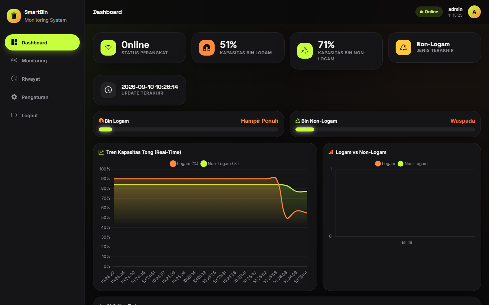
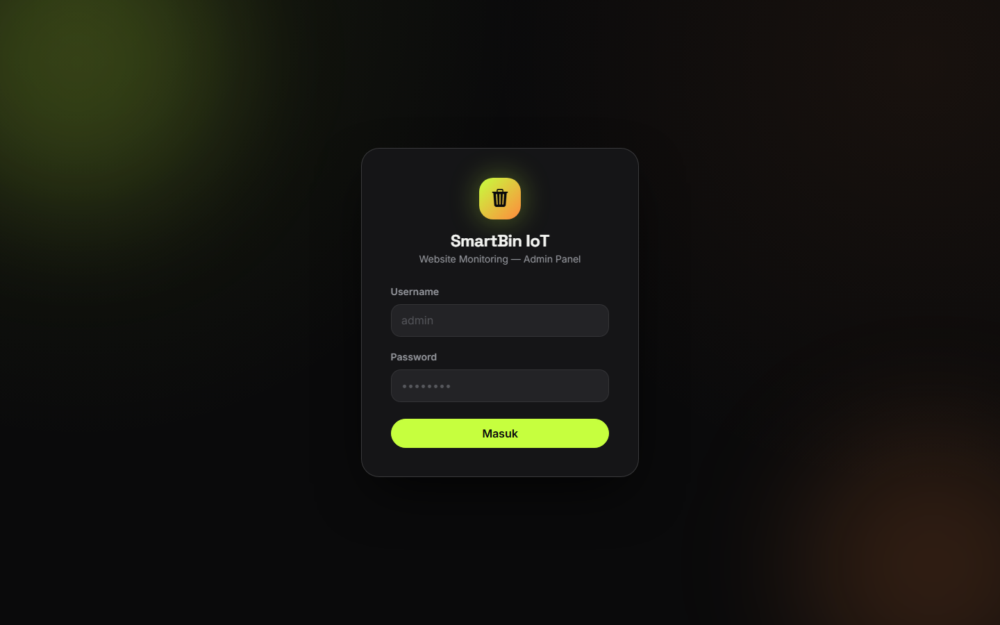
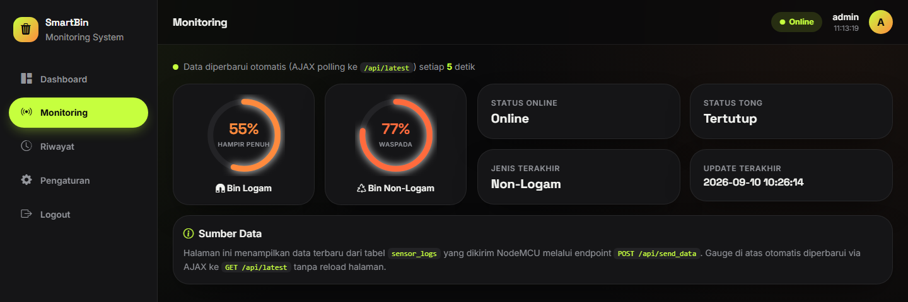
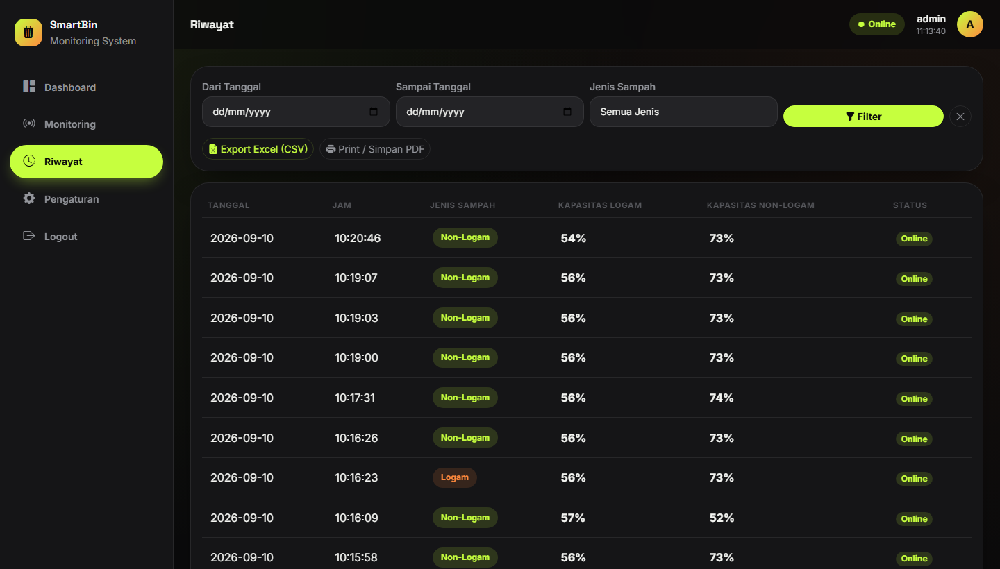
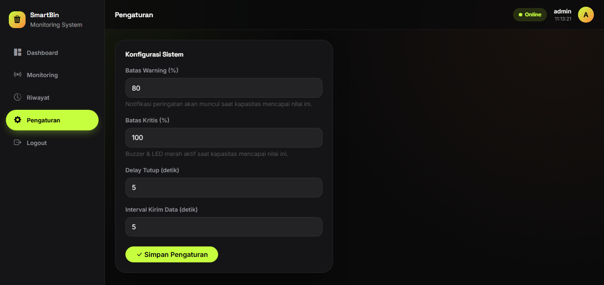
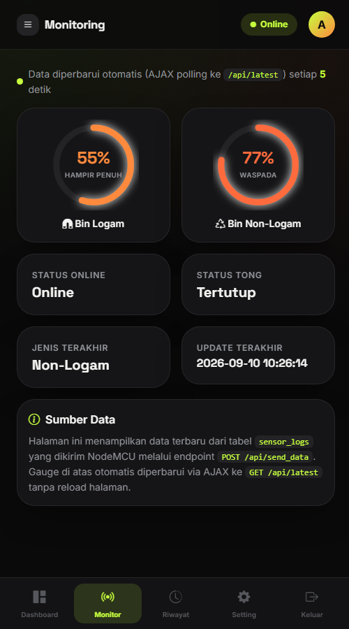

# SmartBin Web

Website monitoring untuk tempat sampah pintar yang bisa memilah sampah **logam** dan **non-logam** secara otomatis. Alatnya pakai NodeMCU ESP8266, lalu data kapasitas tiap bin dan jenis sampah yang terakhir masuk dikirim ke website ini lewat REST API.

Website dibuat dengan CodeIgniter 3 dan MySQL. Data di dashboard diperbarui otomatis tiap beberapa detik tanpa perlu reload halaman.



## Cara Kerja Singkat

1. Sensor infrared mendeteksi ada sampah yang dimasukkan.
2. Sensor proximity induktif mengecek apakah sampah tersebut logam atau bukan.
3. Servo memiringkan pemilah ke bin logam (kanan) atau bin non-logam (kiri).
4. Dua sensor ultrasonik mengukur ketinggian isi masing-masing bin, lalu diubah ke persen.
5. NodeMCU mengirim data ke `POST /api/send_data` dalam format JSON.
6. Website menyimpan data ke tabel `sensor_logs` dan menampilkannya di dashboard.

Ada dua jenis data yang dikirim alat:

- `event`: dikirim setiap kali ada sampah masuk dan dipilah. Data ini yang muncul di halaman Riwayat.
- `heartbeat`: dikirim rutin tiap 5 detik untuk update kapasitas, walaupun tidak ada aktivitas.

## Fitur

- Login admin (password disimpan dengan bcrypt)
- Dashboard berisi status perangkat, kapasitas tiap bin, jenis sampah terakhir, grafik tren kapasitas, dan grafik jumlah logam vs non-logam 7 hari terakhir
- Halaman monitoring dengan gauge kapasitas yang update otomatis (AJAX polling)
- Notifikasi pop-up saat kapasitas melewati batas warning atau kritis
- Riwayat pemilahan dengan filter tanggal dan jenis sampah
- Export riwayat ke CSV dan cetak / simpan sebagai PDF
- Pengaturan batas warning, batas kritis, delay, dan interval kirim data
- Tampilan responsif, di HP menu pindah ke navigasi bawah
- Log aktivitas login/logout admin

## Tampilan

| Login | Monitoring |
| --- | --- |
|  |  |

| Riwayat | Pengaturan |
| --- | --- |
|  |  |

Tampilan di HP:



## Teknologi

**Web**
- PHP 7 ke atas dengan CodeIgniter 3
- MySQL / MariaDB
- Bootstrap 5, Bootstrap Icons
- Chart.js untuk grafik
- SweetAlert2 untuk notifikasi

Semua library front-end sudah disimpan lokal di folder `assets/vendor`, jadi website tetap jalan tanpa internet (cocok kalau alat dan server ada di jaringan lokal yang sama).

**Hardware**
- NodeMCU ESP8266 (ESP-12E)
- 2x sensor ultrasonik HC-SR04 (satu untuk tiap bin)
- 1x sensor infrared obstacle
- 1x sensor proximity induktif
- 1x servo MG90S
- LED dan buzzer sebagai indikator bin penuh

## Struktur Folder

```
smartbin-web/
├── application/
│   ├── controllers/   Login, Dashboard, Monitoring, History, Settings, Api
│   ├── models/        Admin_model, Sensor_model, Dashboard_model, Settings_model
│   └── views/         halaman dan template (header, sidebar, footer)
├── assets/
│   ├── css/style.css
│   ├── js/app.js      polling data, grafik, notifikasi, export CSV
│   └── vendor/        Bootstrap, Chart.js, SweetAlert2, font
├── database/
│   └── smartbin.sql   struktur tabel + akun admin default
├── firmware/
│   └── smartbin_firmware/smartbin_firmware.ino
└── docs/screenshots/
```

## Instalasi

Contoh di bawah pakai Laragon, tapi XAMPP juga bisa.

1. Clone repo ke folder web server.

   ```bash
   cd C:\laragon\www
   git clone https://github.com/<username>/smartbin-web.git
   ```

2. Import database. File SQL sudah otomatis membuat database `smartbin_db`.

   ```bash
   mysql -u root -p < database/smartbin.sql
   ```

   Atau import lewat phpMyAdmin / HeidiSQL.

3. Sesuaikan koneksi database di `application/config/database.php` kalau user atau password MySQL berbeda.

   ```php
   'hostname' => 'localhost',
   'username' => 'root',
   'password' => '',
   'database' => 'smartbin_db',
   ```

4. `base_url` sudah dibuat otomatis mengikuti host yang dipakai, jadi bisa langsung dibuka di `http://smartbin-web.test` (Laragon) atau `http://localhost/smartbin-web`.

5. Login dengan akun default:

   | Username | Password |
   | --- | --- |
   | admin | admin123 |

   Ganti password ini kalau website dipakai di luar jaringan lokal.

## Setting Firmware

Buka `firmware/smartbin_firmware/smartbin_firmware.ino` di Arduino IDE.

Library yang perlu diinstal:
- Board ESP8266 (lewat Boards Manager)
- ArduinoJson versi 6.x

Lalu ubah bagian konfigurasi di atas file:

```cpp
const char* WIFI_SSID     = "nama_wifi";
const char* WIFI_PASSWORD = "password_wifi";
const char* SERVER_URL    = "http://192.168.1.10/smartbin-web/api/send_data";
const char* API_KEY       = "SMARTBIN_API_KEY_2026";
```

`SERVER_URL` diisi IP laptop/server yang menjalankan website, dan NodeMCU harus terhubung ke jaringan yang sama. `API_KEY` harus sama dengan `$apiKey` di `application/controllers/Api.php`.

Tinggi bin dan sudut servo juga bisa dikalibrasi sesuai ukuran fisik alat:

```cpp
const float TINGGI_BIN_LOGAM_CM    = 60.0;
const float TINGGI_BIN_NONLOGAM_CM = 60.0;
const int SERVO_NONLOGAM = 10;
const int SERVO_LOGAM    = 170;
```

### Pin yang dipakai

| Komponen | Pin NodeMCU |
| --- | --- |
| Ultrasonik bin logam (Trig / Echo) | D2 / D1 |
| Ultrasonik bin non-logam (Trig / Echo) | D5 / D6 |
| Sensor infrared obstacle | D3 |
| Sensor proximity induktif | D7 |
| Servo pemilah | D4 |
| LED | D0 |
| Buzzer | RX (GPIO3) |

## API

| Method | Endpoint | Keterangan |
| --- | --- | --- |
| POST | `/api/send_data` | Dipanggil NodeMCU. Wajib header `X-API-KEY` |
| GET | `/api/latest` | Data sensor terbaru (perlu login) |
| GET | `/api/summary` | Data untuk kartu ringkasan dan grafik dashboard (perlu login) |
| GET | `/api/history` | Riwayat event, bisa difilter `start_date`, `end_date`, `waste_type` (perlu login) |

Contoh body untuk `/api/send_data`:

```json
{
  "capacity_logam": 55,
  "capacity_non_logam": 77,
  "waste_type": "Non-Logam",
  "lid": "Closed",
  "status": "Online",
  "trigger_type": "event"
}
```

Bisa dites tanpa alat pakai curl:

```bash
curl -X POST http://smartbin-web.test/api/send_data \
  -H "Content-Type: application/json" \
  -H "X-API-KEY: SMARTBIN_API_KEY_2026" \
  -d '{"capacity_logam":40,"capacity_non_logam":65,"waste_type":"Logam","trigger_type":"event"}'
```

Nilai kapasitas otomatis dibatasi 0 sampai 100, dan nilai yang tidak dikenal akan diganti ke default sebelum disimpan.

## Database

| Tabel | Isi |
| --- | --- |
| `admin` | Akun login admin |
| `sensor_logs` | Semua data yang dikirim alat (event dan heartbeat) |
| `settings` | Batas warning, batas kritis, delay, interval kirim |
| `activity_log` | Catatan login dan logout admin |

## Catatan

- Nilai batas warning/kritis di halaman Pengaturan dipakai website untuk notifikasi. Di firmware nilainya masih ditulis manual (default 80 dan 100), jadi kalau diubah di website, ubah juga di firmware.
- Sebelum website dipasang online, pindahkan API key ke config terpisah dan ganti password admin default.
